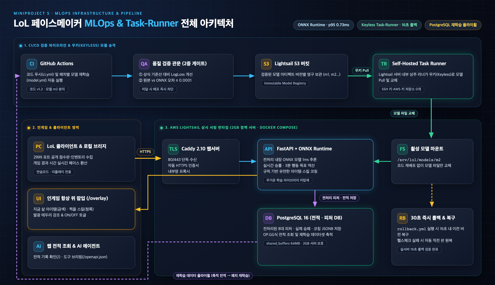

# LoL 페이스메이커 (페이커)

> **연습모드·리플레이·봇전에서 점수판(Tab) 공개 정보만으로 10인 전 라인·보유 골드·아이템·오브젝트·생존 타이머를 종합해 실시간 맞춤 전략·빌드·스킬을 프레임 없는 인게임 팝업 HUD로 안내하는 AI LoL 코치 & MLOps 파이프라인 (`v1.28`)**

---

## 1. 바로 접속 및 원클릭 실행

| 용도 | 주소 | 설명 |
|---|---|---|
| **데스크톱 원클릭 다운로드** | **`https://jjm.eta.pyhub.kr/download`** (로컬: `http://127.0.0.1:8083/download`) | Windows(`.bat`) · macOS(`.zip`) 내려받아 더블클릭 실행 |
| **웹 시뮬레이터 · 전적 DB** | **`https://jjm.eta.pyhub.kr/`** | 설치 없이 브라우저에서 코칭 체험 및 PostgreSQL 전적 저장 |
| **인게임 HUD 미리보기** | **`https://jjm.eta.pyhub.kr/overlay`** | 프레임 없는 반투명 HUD · 전 라인·실시간 전략·아이템·스킬·AI 브리핑 |
| **5분 발표 웹 슬라이드** | **`https://jjm.eta.pyhub.kr/slides`** | 8장 웹 프레젠테이션 (`→`·스페이스로 이동, 8장은 실게임 시연 영상) |
| **실게임 시연 영상 (56초)** | **`https://jjm.eta.pyhub.kr/slides#8`** · 파일 [`docs/demo_intro.mp4`](docs/demo_intro.mp4) | 자막·내레이션 완성본. 컷 편집본 [`docs/demo_intro_cut.mp4`](docs/demo_intro_cut.mp4), 장면·근거 [`docs/demo_intro.md`](docs/demo_intro.md) |
| **서버·모델 상태 확인** | **`https://jjm.eta.pyhub.kr/health`** | 코드 판(`app_version`) · 모델 판(`model_version`) 조회 |

### PC 인게임 오버레이 10초 실행 (터미널 창 없음)
1. **`https://jjm.eta.pyhub.kr/download`** (또는 로컬 `http://127.0.0.1:8083/download`)에서 OS에 맞는 파일 다운로드
2. 더블클릭 실행 (Windows는 `pythonw` 무터미널 백그라운드 실행, 끌 때는 HUD 우측 상단 `×` 버튼)
3. Windows 10/11 전체 화면 최적화(FSO) 환경에서는 전체 화면에서도 표시를 시도하며, 가려지면 롤 설정을 **`테두리 없음(Borderless)`**으로 전환 (`F8` 클릭 통과 · `F9` 숨김)
4. 로컬 Ollama(`qwen3:4b-instruct-2507-q4_K_M`)와 함께 쓰려면 저장소의 [`scripts/run_local_ollama.bat`](scripts/run_local_ollama.bat) 실행

---

## 2. 왜 만들었나 & 핵심 기능

기존 전적 사이트는 게임이 끝난 뒤에야 분석표를 보여 주고, 경기 중에는 고정된 통계 템트리만 나열합니다. **LoL 페이스메이커(페이커)**는 부정행위(안개 속 정보) 없이 **점수판(Tab) 공개 정보만** 읽어 프로 감독처럼 유연하게 코칭합니다.

1. **실시간 다요인 맞춤 전략 (`POST /strategy`, `POST /strategy/briefing`)**: 게임 페이즈(초반·중반·후반), 10인 전 라인 우열, 보유 골드·하위템 차감 귀환 판정, 용·장로·유충·바론·억제기·생존 타이머, 상대 조합(치감·관통)을 종합해 우선순위 전략 카드와 검증된 2문장 AI 감독 브리핑 생성
2. **프레임 없는 Windows 인게임 팝업 HUD (`client/bridge.py`)**: `WS_POPUP | WS_EX_TOPMOST | WS_EX_TOOLWINDOW | WS_EX_LAYERED | WS_EX_NOACTIVATE`로 제목줄 제거·작업표시줄 숨김·OS 반투명·포커스 미탈취, LoL 창 자동 추적 및 포그라운드 Z-순서 유지, `F8`/`F9` 전역 단축키, `bridge_version` 판 비교 및 `X-Bridge-Token` 보안 제어
3. **10분 기준 MLOps 진단·목표 API (`POST /predict`, `POST /coach`)**: 10분 기준 ONNX 모델 승률·티어 백분위·3분 정량 목표·상대 공개 아이템 기반 빌드·스킬 가이드 제공 (OpenAPI AI 에이전트 도구 호환)
4. **전적 축적 & 재학습 루프 (`POST /matches`, `GET /matches/export`)**: 경기 후 전처리된 8대 피처와 승패를 PostgreSQL에 저장하고, 학습 CSV 형식으로 내보내 모델 재학습에 환류

---

## 3. MLOps 아키텍처



| 핵심 원칙 | 구현 방식 | 효과 |
|---|---|---|
| **성능 게이트** | 상식 규칙 기준선(`rule.py`)보다 Brier/LogLoss가 좋을 때만 배포 | 나쁜 모델 자동 차단 (`dl` 400회 Brier 0.2197 차단 실측) |
| **ONNX 일치(Parity)** | 전처리를 모델 안에 구워 `onnxruntime`으로 서빙, 원본과 오차 `<= 0.0001` 검증 | 학습·서빙 차이 제거, 로컬 p95 **0.73ms** |
| **코드·모델 분리** | 코드 판(`v1.x`)과 모델 판(`mYYYYMMDD-N`) 분리 | 코드 재배포 없이 모델만 교체 및 **16초 즉시 롤백** |
| **무키(Keyless) 배포** | Lightsail 내부 Self-Hosted Runner + 버킷 리소스 액세스 | 저장소에 SSH 키·AWS 키 0개 |
| **PostgreSQL 루프** | `postgres:16-alpine` (`shared_buffers=64MB`) + SQLite 테스트 폴백 | 2GB 서버 보호 및 동시 전적 적재·추출 지원 |

---

## 4. 실측 검증 결과

| 항목 | 실측 수치 | 근거 |
|---|---|---|
| **자동 테스트** | **449 passed** (`uv sync --all-groups` 시 skipped 0, Windows 에서는 `.env` 0600 권한 검사 1건이 파일 시스템 차이로 실패) | `uv run pytest api client tests deploy -q -rs` |
| **성능 게이트 (`m1` → `m2`)** | `m1`(500경기) Brier 0.1891 → `m2`(5,000경기) **0.1824** (규칙 대비 +4.84%) | [docs/model_comparison.md](docs/model_comparison.md) |
| **ONNX 일치 (Parity)** | 원본 sklearn vs ONNX 23건 최대 오차 `1.19e-07` (허용 `0.0001`) | `training/check_parity.py` |
| **서빙 부하 (로컬 / 실서버)** | 로컬 ONNX `/predict` p95 **0.73ms**, 실서버 160건 동시 10건 **성공률 100%** | [docs/benchmark_summary.json](docs/benchmark_summary.json), [docs/benchmark_cloud_summary.json](docs/benchmark_cloud_summary.json) |
| **클라우드 승격 · 롤백** | `model.yml` 2회 승격 · `rollback.yml` **16초 롤백** 실서버 완료 | GitHub Actions 실행 이력 |

---

## 5. 로컬 개발 및 테스트 실행

```bash
git clone https://github.com/wpalswpa/lol-pace-mlops.git
cd lol-pace-mlops
uv sync --all-groups
uv run pytest api client tests -q -rs
MODEL_IMPL=onnx uv run uvicorn api.app:app --port 8083
```

### 저장소 구조 & 읽는 순서

- **`api/`**: FastAPI 서버 (`app.py`, `contract.py`, `db.py`, `build.py`, `service.py`, `strategy.py`, `llm_coach.py`, `static/{index,overlay,download,slides}.html`)
- **`client/`**: 로컬 게임 브리지·Win32 팝업 제어 (`bridge.py`), Electron 투명 오버레이 셸 (`overlay_electron.js`), macOS 투명 플로팅 패널 (`overlay_popup.swift`), OpenAPI 에이전트 데모 (`agent_demo.py`)
- **`scripts/`**: 로컬 Ollama 원클릭 실행기 (`run_local_ollama.bat`), 부하 실측 (`benchmark_serving.py`)
- **`training/`**: 데이터 로더, 규칙/sklearn/PyTorch 학습, 성능 게이트, ONNX 변환 및 Parity 검증
- **`deploy/lightsail/`**: `compose.yml` (`api` + `postgres:16-alpine` + `caddy`), `server.sh`, `Caddyfile`
- **상세 계약 정본**: [AGENTS.md](AGENTS.md)
