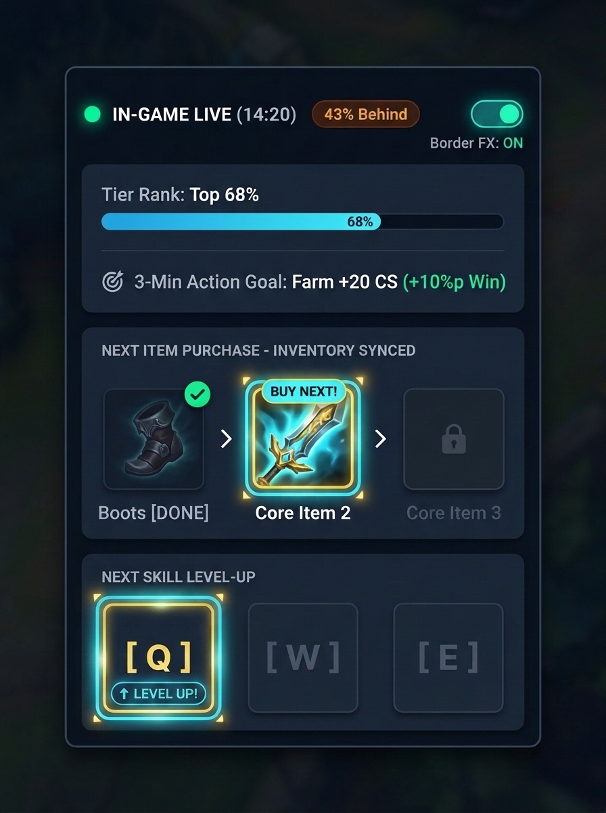
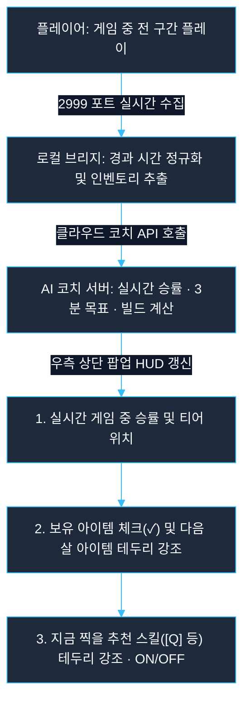
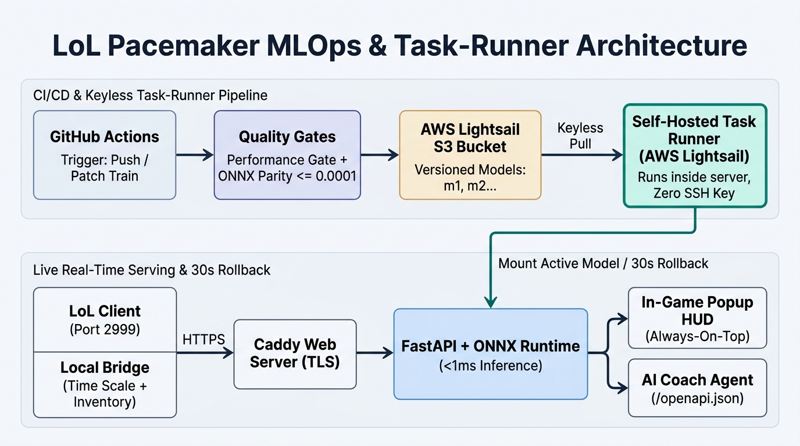
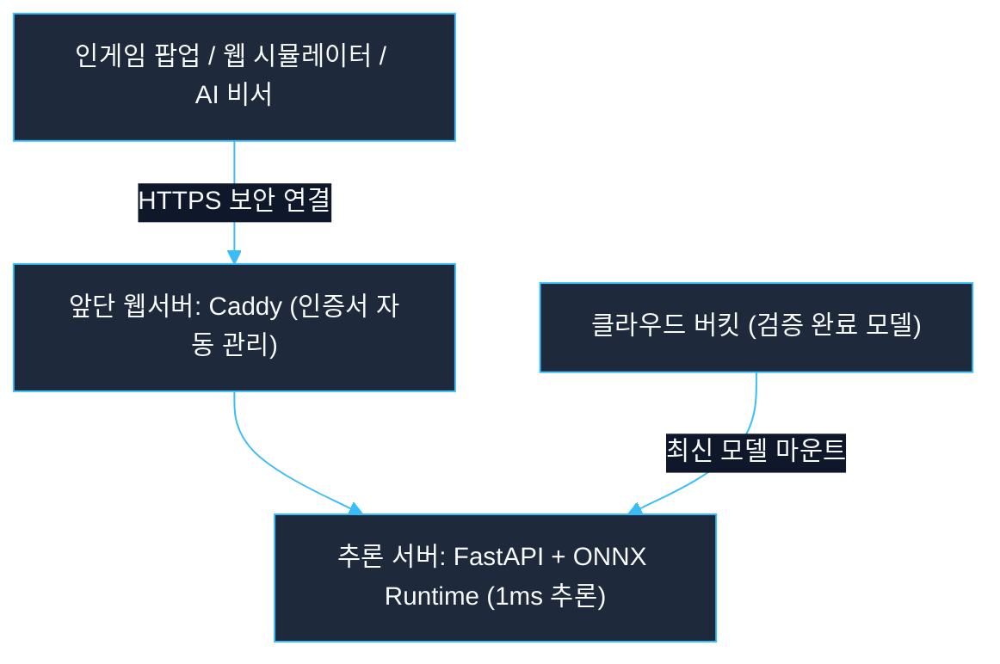
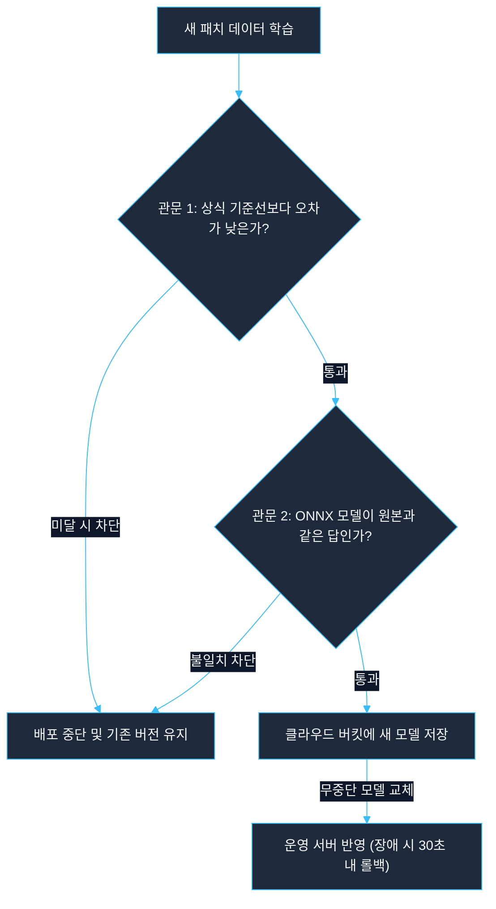

# 미니프로젝트 5 LoL 페이스메이커(페이커) 구축 계획서

## 1. 프로젝트 배경과 목표

리그 오브 레전드(LoL)를 플레이할 때 가장 답답한 순간은 **"지금 우리 팀이 유리한지 불리한지, 당장 무엇부터 해야 이길 수 있는지"** 판단이 서지 않을 때다.

이전 프로젝트에서는 경기가 끝난 뒤 데이터로 승패 원인을 되짚어 주는 복기 서비스를 만들었다. 하지만 일반 이용자는 이미 끝난 경기의 분석표를 보러 다시 찾아오지 않았고, 정작 승패를 바꿀 수 있는 **게임 도중**에는 아무런 도움을 받지 못했다. 기존 전적 사이트들 역시 현재 경기 상황과 무관하게 똑같은 고정 아이템과 스킬만 추천할 뿐이었다.

그래서 이번 프로젝트에서는 마라톤 선수의 옆에서 속도와 목표를 잡아 주는 페이스메이커이자 전설적인 게이머의 이름을 합친 **'LoL 페이스메이커(페이커)'**를 기획했다. 끝난 뒤의 복기가 아니라 **게임 도중(초반 라인전부터 후반 한타까지 전 구간)에 실시간으로 내 위치를 진단하고, 승리를 위한 다음 행동과 아이템·스킬을 지시해 주는 AI 감독·코치 서비스**다. 나아가 2주마다 바뀌는 게임 패치에 맞춰 서비스를 멈추지 않고 모델만 새로 학습해 교체하는 **클라우드 자동 운영 체계(MLOps)**를 함께 구축한다.

| 비교 항목 | 기존 프로젝트 (사후 복기) | 이번 프로젝트 (LoL 페이스메이커) |
|---|---|---|
| **판단 시점** | 경기가 끝난 뒤에야 승패 원인 확인 | **게임 중 전 구간 실시간** 승률·티어 내 위치 진단 |
| **데이터 기준** | 경기 중 볼 수 없는 비공개 데이터 의존 | 누구나 볼 수 있는 **공식 공개 데이터만 합법 활용** |
| **빌드 추천** | 상황과 무관한 고정 아이템·스킬 추천 | **현재 우세·열세와 상대 위협**에 맞춘 운영·빌드 지시 |
| **모델 운영** | 수동 모델 관리 및 서버 재배포 | **코드와 모델 분리**, 자동 검증 배포 및 30초 롤백 |

---

## 2. 서비스 핵심 기능과 화면 설계

### 2.1 무엇을 알려 주는가 (네 가지 코칭 기능)

반칙(비공개 정보 조회) 없이 게임 클라이언트가 공식 제공하는 점수판 공개 지표(킬, 어시스트, 미니언 처치 수, 레벨, 드래곤·전령·포탑 등)와 공식 아이템·챔피언 데이터를 결합해 네 가지를 안내한다.

| 단계 | 코칭 기능 | 플레이어와 AI 비서에게 전달하는 내용 |
|---|---|---|
| **1단계** | **현재 페이스 진단** | 우리 팀 예상 승률(%)과 같은 실력대 분포 안의 내 위치(상위 몇 %) |
| **2단계** | **격차 원인 파악** | 지금 승률을 가장 크게 깎고 있는 핵심 원인 3가지 |
| **3단계** | **다음 3분 행동 목표** | 앞으로 3분 동안 채우면 승률이 가장 많이 오르는 목표치(미니언·득점·포탑 등) |
| **4단계** | **상황별 아이템·스킬 지시** | 현재 우세·열세 상태와 상대 핵심 위협에 맞춘 추천 아이템 3단계 및 스킬 순서 |

### 2.2 어떻게 보여 주는가 (인게임 팝업 오버레이와 추천 강조 테두리 이펙트)

초보자는 웹 브라우저를 따로 열어 긴 글을 읽거나 상점에서 아이템 이름을 검색할 여유가 없다. 따라서 OP.GG 데스크톱 앱처럼 **인게임 화면 우측 상단에 항상 떠 있는 컴팩트 팝업(오버레이 HUD)**으로 연결하고, **지금 당장 사야 할 아이템과 찍어야 할 스킬에 빛나는 강조 테두리 이펙트**를 씌워 글자를 읽지 않고도 바로 따라 하게 한다.

| HUD 영역 | 표시 내용 및 사용자 행동 |
|---|---|
| **상단 상태 바** | `게임 중 LIVE (경과 시간)` 배지, 실시간 승률(우세·박빙·열세), **테두리 강조 이펙트 ON/OFF 토글**, 접기 버튼 |
| **페이스 · 목표 카드** | 같은 티어 분포 내 현재 위치(상위 %) 막대와 앞으로 3분간 승률을 가장 크게 높일 행동 목표 1개 |
| **아이템 구매 가이드** | 인벤토리 연동 완료(`✓`) 처리 후, **지금 당장 살 다음 1개 아이템 아이콘 둘레에 발광 네온 테두리 강조** |
| **스킬 레벨업 가이드** | 현재 레벨 기준 **우선 찍을 스킬 키(`[Q]`, `[W]`, `[E]`, `[R]`) 둘레에 발광 네온 테두리 강조** |

- **인게임 팝업 오버레이 연결**: PC 로컬 브리지가 게임 클라이언트 데이터를 실시간으로 읽어 클라우드 서버와 통신하고, 게임 창 위에 항상 떠 있는 팝업으로 결과를 띄운다.
- **구매·스킬 강조 테두리 이펙트 및 ON/OFF**: 플레이어가 이미 산 아이템은 완료 표시(`✓`)로 넘기고, **지금 당장 사야 할 다음 단계 아이템 아이콘과 먼저 찍어야 할 스킬 키(`[Q]`)에 반짝이는 강조 테두리 이펙트**를 띄운다. 플레이어 취향에 맞춰 이펙트와 음성 안내를 언제든 껐다 켤 수 있다.
- **AI 음성 비서·챗봇 연동**: 일반 대화형 AI가 어림짐작으로 잘못된 조언을 하지 않도록, 우리 서버가 계산한 승률과 목표 수치를 그대로 가져다 브리핑하게 연결한다.

---

## 3. MLOps 시스템 아키텍처 설계

2주마다 게임 패치가 바뀌어도 서비스가 멈추거나 엉뚱한 예측을 내보내지 않도록, 다섯 가지 MLOps 핵심 원칙과 Self-Hosted Task Runner 기반으로 시스템을 설계한다.

**① 실시간 코칭 서빙 구조 (AWS Lightsail 상시 운영)**

**② 자동 학습 · 검증 관문 · 무중단 승격 및 30초 롤백**

### 왜 이 구조로 설계했는가 (5대 설계 이유)

1. **규칙 기준선과 머신러닝 모델의 경쟁**: 먼저 게임 상식("골드 격차에 비례해 승률이 오른다")으로 기준선을 세우고, 머신러닝 모델(로지스틱 회귀, 딥러닝)은 기준선보다 예측 확률이 더 정확할 때만 배포 관문을 통과시킨다. 최종 서빙 모델은 승률 기여도와 목표치를 투명하게 역산할 수 있는 로지스틱 회귀를 쓴다.
2. **전처리 내장 표준 포맷(ONNX) 서빙**: 데이터를 평균과 표준편차로 맞추는 과정을 모델 파일 안에 통째로 구워 넣어 학습과 서빙의 계산 차이를 없앤다. 서버에는 가벼운 실행 엔진만 올려 메모리를 아끼고 빠르게 응답한다.
3. **서버 코드 버전과 모델 버전의 분리**: 패치가 바뀌어 재학습할 때 서버 프로그램을 다시 만들지 않도록, 서버 코드 버전(`v1.0`)과 인공지능 모델 버전(`일자별 번호`)을 나눠 모델 파일만 교체한다.
4. **역할별 서버 분리와 무키(Keyless) 보안**: 가벼운 실시간 서빙은 정액 서버(Lightsail)에서 24시간 돌리고, 무거운 대량 학습은 필요할 때만 고성능 서버(EC2)를 켜서 비용을 아낀다. 서버 안에 작업 대리인(러너)을 등록해 외부에 비밀번호나 열쇠 파일을 두지 않는다.
5. **30초 즉시 롤백과 자동 복구**: 클라우드 버킷에 이전 모델 버전들을 보관해 두어, 새 모델에 문제가 생기면 재학습 없이 30초 안에 이전 버전으로 되돌린다. 배포 중 응답 확인에 실패하면 스크립트가 스스로 직전 버전으로 복구한다.

---

## 4. AI 협업 및 검증 계획

AI 코딩 도구를 단순 자동 생성기로 쓰지 않고, **사람이 먼저 설계 규칙과 합격 기준을 정한 뒤 AI가 이를 통과하도록 구현과 검증을 반복**한다.

| 구분 | 사람이 직접 정하고 통제하는 기준 | AI 도구를 활용해 구현하는 작업 |
|---|---|---|
| **서비스 규칙** | 공개 지표 8종 선정, 비정상 입력 거절 규칙, 백분위·목표 역산 원리 | 서버 API, 게임 연동 브리지, 시각 코칭 웹 화면 구현 |
| **품질 관문** | 기준선 대비 예측 오차 개선 기준, 원본·변환 모델 일치 허용치(`0.0001`) | 학습 코드, 표준 포맷 변환기, 서버 간 자동 대조 시험 작성 |
| **배포·복구** | 코드·모델 버전 분리 규칙, 무키 보안 원칙, 실패 시 자동 복구 조건 | 자동 배포 워크플로 작성 및 승격·롤백 모의시험 |

- **검증 4단계**: ① 정상·비정상 입력 테스트 및 일부러 심은 버그를 테스트가 잡아내는지 확인(뮤테이션 검증) ② 기준선 미달 모델의 배포 차단 확인 ③ 원본 모델과 경량 서빙 모델의 응답 일치 확인 ④ 서버 중단 없는 모델 버전 교체 및 30초 롤백 확인.

---

## 5. 추진 일정 (11월 24일 발표 기준)

| 일정 | 단계 | 핵심 과업 | 완료 확인 기준 |
|---|---|---|---|
| **11월 18일(수)** | **1단계: 핵심 모델 및 검증 관문** | 8대 공개 지표 모델 설계, 성능 게이트 및 경량 포맷(ONNX) 변환·일치 검증 구현 | 단위 테스트 및 모델 변환 일치 통과 |
| **11월 19일(목)** | **2단계: 인게임 팝업 UI 및 브리지** | 인게임 항상 위 팝업 오버레이, 추천 아이템·스킬 테두리 강조 이펙트(ON/OFF) 및 연동 브리지 구현 | 가짜 버그 주입 검출 및 인게임 팝업 연동 확인 |
| **11월 20~21일** | **3단계: 클라우드 서버 및 자동 배포** | AWS Lightsail 서버·버킷 연결, 무키 러너 등록, 보안 연결(HTTPS) 및 첫 배포 | 클라우드 서버 실시간 응답 및 웹 시뮬레이터 확인 |
| **11월 22일(일)** | **4단계: 모델 무중단 승격·롤백 점검** | 패치 데이터 재학습 승격, 30초 롤백 실측, 게임 연습모드·리플레이 연동 확인 | 버전 전환 로그 및 클라이언트 연동 확인 |
| **11월 23~24일** | **5단계: 5분 발표 자료 및 리허설** | 아키텍처 설계 이유와 전체 흐름, AI 주도적 활용 중심 5분 발표 준비 | 5분 발표 및 실시간 시연 점검 완료 |
